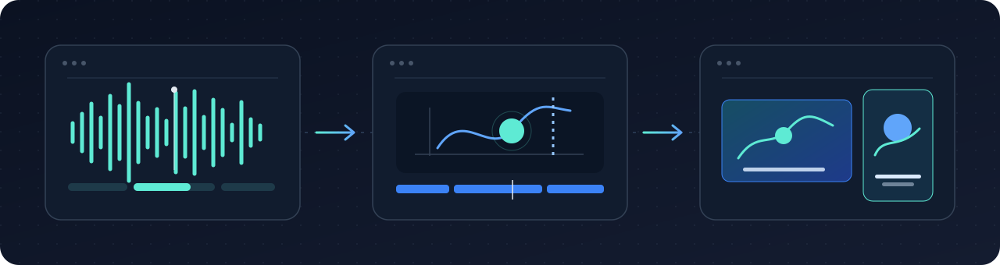
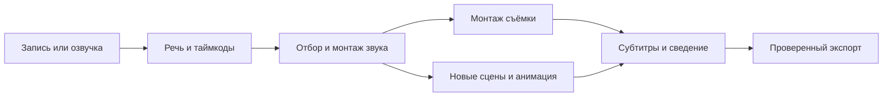

# Media Studio



**Из длинной записи в готовые ролики. Из речи в новую анимацию.**

Навык для Codex: отбирает сильные моменты подкаста, монтирует длинные видео, создаёт новый видеоряд по смыслу речи и собирает результат с оригинальным голосом, субтитрами и звуком.

[](https://github.com/NGerasimoB/media-studio/releases/latest)


**[Скачать ZIP](https://github.com/NGerasimoB/media-studio/releases/latest/download/media-studio.zip)** · **[Установка](#установка)** · **[Примеры запросов](#примеры-запросов)** · **[Как это работает](#как-это-работает)**

## Что можно сделать

| Задача | Результат |
| :--- | :--- |
| Длинный подкаст → короткие ролики | Самостоятельные фрагменты с понятным началом, законченной мыслью и исходным голосом |
| Озвучка → новый видеоряд | Сцены, схемы, коллажи и анимация, созданные специально под смысл речи |
| Урок, интервью или вебинар | Длинный монтаж с сохранением логики, демонстраций и естественных пауз |
| Субтитры | Пословные метки с пересчётом времени после склеек и перестановок |
| Обработка звука | Коррекция конкретных дефектов, сведение музыки и эффектов, измерение уровня |
| Версии для разных площадок | Отдельная композиция для 16:9, 9:16, 1:1 и 4:5 |

### Когда нужен совершенно новый видеоряд

Можно дать только аудио. Навык разберёт речь, выберет моменты и построит изображение вокруг сказанного: объект столкнётся с преградой, схема покажет причинную связь, диаграмма наглядно сравнит варианты. Оригинальная речь задаёт время и смысл сцен.

Стиль выбирается под задачу: бумажный коллаж, чистая инфографика, кинетическая типографика, документальная подача, спокойный учебный монтаж, продуктовая демонстрация или кинематографичная история.

## Установка

### Через ZIP

1. **[Скачай архив](https://github.com/NGerasimoB/media-studio/releases/latest/download/media-studio.zip)** и распакуй его. Внутри находится папка `media-studio`.
2. **Перенеси папку** в каталог навыков Codex. По умолчанию это `~/.codex/skills/`, на Windows: `%USERPROFILE%\.codex\skills\`. При заданном `CODEX_HOME` используй его подкаталог `skills`.
3. **Открой новую задачу в Codex** и обратись к навыку через `$media-studio`.

Итоговый путь должен выглядеть так:

```text
~/.codex/skills/media-studio/SKILL.md
```

### Через Git

Выполни из каталога навыков:

```shell
git clone https://github.com/NGerasimoB/media-studio.git media-studio
```

### Подготовить инструменты

Установленный навык задаёт способ работы. Обработку выполняют локальные программы, выбранные под конкретную задачу:

| Инструмент | Для чего нужен |
| :--- | :--- |
| **FFmpeg / FFprobe** | Монтаж, конвертация, звук, проверка готового файла |
| **Python + faster-whisper** | Распознавание речи и пословные таймкоды |
| **Node.js + Remotion** | Новая анимация, графики, сложные субтитры |
| **Hyperframes** | Альтернативная сборка HTML/GSAP и продолжение существующих проектов |

В комплекте находятся инструкции и два Python-помощника. Программы, браузеры, модели распознавания и исходные медиа устанавливаются или предоставляются отдельно по задаче. Помощник распознавания использует локально сохранённый `large-v3` и NVIDIA CUDA / float16. Для простого обрезания или конвертации достаточно FFmpeg.

Первый запрос после установки:

```text
$media-studio
Проверь готовность среды для монтажа и анимации: FFmpeg,
Python/faster-whisper и Remotion. Найди уже установленные версии.
Покажи, чего не хватает, и предложи минимальную настройку.
```

Подключение инструментов описано в [runtime.md](references/runtime.md).

## Примеры запросов

### Найти сильные моменты в подкасте

```text
$media-studio
Изучи весь подкаст podcast.mp4 и выбери три сильных фрагмента
для людей, которые меня ещё не знают. Сделай три ролика по 30–60 секунд,
9:16, с оригинальным голосом и пословными субтитрами.
Для каждого создай новый анимированный видеоряд по смыслу речи.
Стиль: бумажный коллаж, тёплая палитра, спокойная типографика.
```

### Создать анимацию по готовой озвучке

```text
$media-studio
По voice.wav создай объясняющий ролик 16:9.
Покажи идеи через причинные действия объектов и простые схемы.
Сохрани оригинальную речь, добавь субтитры.
Визуальный ориентир: чистая инфографика, светлый фон, синий акцент.
Нужны MP4 и папка проекта.
```

### Смонтировать длинный урок

```text
$media-studio
Смонтируй lesson.mp4: убери технические дубли и пустое ожидание,
сохрани объяснения, показ экрана и смысловые паузы.
Выровняй голос. Добавь крупные пояснения в сложных местах.
Формат 1920×1080. Отдай готовый MP4 и сборку.
```

### Изменить готовую версию

```text
$media-studio
Открой существующую сборку в папке project.
Сократи вступление, увеличь субтитры и подготовь версию 9:16.
Сохрани выбранные сцены, голос и стиль.
```

## Как это работает



Сначала фиксируется монтаж речи. Затем под его итоговое время строятся сцены и субтитры. После каждой новой склейки метки пересчитываются, поэтому слово из середины исходного подкаста подсвечивается в нужный момент короткого ролика.

Готовая работа включает заказанные файлы и папку со сборкой. Для новых сцен это код, ассеты и монтажные диапазоны, которые можно дальше менять словами.

## Что внутри

| Файл | Назначение |
| :--- | :--- |
| [SKILL.md](SKILL.md) | Общий маршрут и выбор режима |
| [workflows.md](references/workflows.md) | Длинный монтаж, отбор фрагментов, речь → новый видеоряд, версии |
| [direction.md](references/direction.md) | Смысловая постановка, стили, движение и композиция |
| [audio-captions.md](references/audio-captions.md) | Звук, склейки речи, субтитры и единое время |
| [runtime.md](references/runtime.md) | Локальные инструменты, рендер и проверка экспорта |
| [sources.md](references/sources.md) | Источники методов и исследованные версии |
| [transcribe_words.py](scripts/transcribe_words.py) | Локальная речь → JSON с пословными метками |
| [remap_words.py](scripts/remap_words.py) | Пересчёт меток через склейки, перестановки и изменение скорости |

Соседние навыки `brag`, `opus-sound-layer` и `transcribe-local-media` подключаются, если уже установлены. Базовый маршрут находится в этом пакете.

## Проверка помощника таймкодов

Тесты используют стандартную библиотеку Python. Запускай из корня скачанного пакета:

```shell
python -B -m unittest discover -s tests -v
```

Проверяются склейки, перестановка фрагментов, изменение скорости, конец записи и отклонение разрезов внутри слова.
